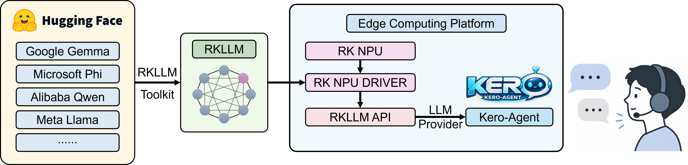
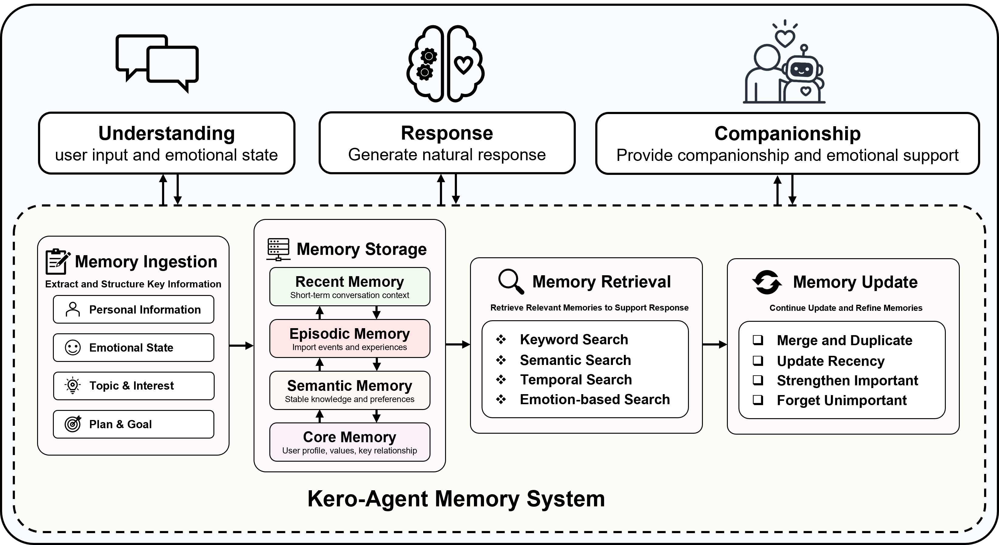
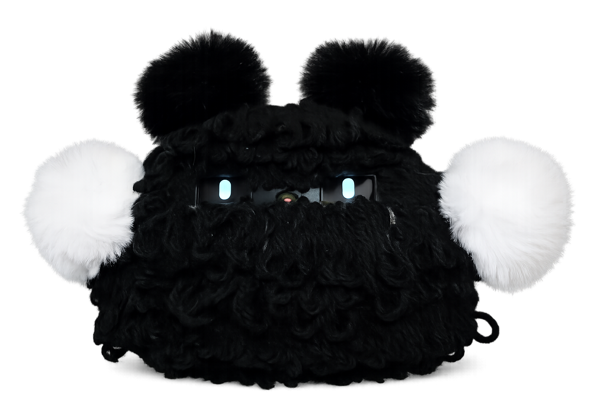

# Kero-Agent: An Edge-Native Companion Robot with Hierarchical Memory and Local Large Language Model

**Mingshan He and Hiroto Tanaka**  
Department of Mechanical Engineering, Institute of Science Tokyo

*IEEE/SICE International Symposium on System Integration (SII 2027)*

[**Project Page**](https://mingshanhe.github.io/Kero-Agent/) | [**Code**](https://github.com/MingshanHe/Kero-Agent) | **Paper** (link coming soon)

<p align="center">
  
</p>

## Overview

Companion robots for homes and care environments need fast responses and long-term memory of their users. Cloud-based inference sends interaction data to external services and adds ongoing API costs. **Kero-Agent** is an edge-native companion robot built on the Rockchip **RK3588**. It combines:

- **Local LLM inference** on the RK3588 NPU. Open-source models are converted to the RKLLM format and served through an OpenAI-compatible local endpoint.
- **Hierarchical long-term memory** with recent, episodic, semantic, and core layers, all stored as local files.
- **Asynchronous reflection**, which updates the user profile and long-term memory after the reply has been delivered. Model weights are never changed.
- **Multimodal sensing and embodied output**: microphone, IMU, pressure sensors, and camera as inputs; local text-to-speech and OLED eye animations as outputs.

During normal dialogue and memory processing, no network connection is required.

## Key Results

| Evaluation | Result |
| --- | --- |
| Onboard inference, best 1B-class models (Gemma-3-1B, Llama-3.2-1B) | TTFT ≈ 75 ms, ≈ 15 tokens/s |
| Onboard inference, Gemma-2-2B | TTFT ≈ 210 ms, 7.2 tokens/s |
| 30-day memory stress test (72 simulated users, 103,680 probes) | Success@8 = 0.863, Top-1 = 0.799, MRR = 0.818 |
| Stable-seed / anchored-event retrieval | 1.000 on all metrics |
| Current-preference retrieval (after revisions) | Success@8 = 0.995 |
| Low-overlap (paraphrased) retrieval | Success@8 = 0.279 (main target for future work) |

The paper sets feasibility requirements before reporting results:

- **R1, response onset:** TTFT < 0.5 s, within a ~1 s robot response budget.
- **R2, speech continuity:** generation must stay ahead of speech playback (more than ~3–4 tokens/s).
- **R3, memory availability:** the target evidence must appear in the top-8 candidates, and revised preferences must rank above stale ones.
- **R4, locality:** dialogue, memory, and inference run on the device.

The 1B-class configurations meet R1 and R2 with margin. R4 holds by design. R3 is met for every retrieval condition except low-overlap queries.

## Hierarchical Memory

<p align="center">
  
</p>

| Layer | Purpose | Implementation |
| --- | --- | --- |
| Recent | Short-term dialogue context | Last 8 turns plus `data/sessions/current.jsonl` |
| Episodic | Events, reflections, extracted facts | `data/memory/long_term.jsonl` (importance, timestamp, tags) |
| Semantic | Structured preferences, styles, topics | `data/profile/profile.json` (latest 40 entries per list) |
| Core | Stable user profile and companion strategy | `data/memories/USER.md` (3,000 chars) and `MEMORY.md` (5,000 chars), injected into every prompt |

**Retrieval.** Each stored item *m* is scored against the query *q* with a lightweight local function. No external embedding model or vector database is used, so retrieval does not compete with the LLM for the NPU:

```
s(q, m) = 0.50 * s_sem + 0.30 * s_lex + 0.12 * importance + 0.08 * s_rec
```

- `s_sem` is the cosine similarity of 256-d signed feature-hashing vectors.
- `s_lex` is the fraction of query tokens that also appear in *m*.
- `s_rec = 0.5^(age_days / 60)`.

Items scoring at least `recall_min_score` (0.04) are ranked. The top-`k` items are inserted into the prompt as a separately marked memory block. See [`kero/memory/retrieval.py`](kero/memory/retrieval.py).

**Governance.** Memory updates follow explicit rules:

- Exact duplicates are not stored.
- A revision or removal must match exactly one entry by substring.
- When the long-term store exceeds its character budget, the lowest-importance items are pruned first, then the oldest.
- Every write is scanned for prompt-injection phrases, secret-exfiltration commands, and invisible Unicode characters ([`kero/memory/safety.py`](kero/memory/safety.py)).

**Reflection.** Reflection runs every 8 turns (once at least 3 turns exist), on `/reflect`, and on `/exit`. The LLM returns strict JSON with a session summary, a profile update, and a list of durable memories. If no LLM is available, or its output cannot be parsed, a rule-based extractor is used instead. See [`kero/evolution/reflection.py`](kero/evolution/reflection.py).

## Hardware Prototype

<p align="center">
  
</p>

- **Main computer:** LubanCat 4 (RK3588 SoC with a 6-TOPS NPU). It runs the local LLM, memory, ASR/TTS, and robot control.
- **Sensor hub:** Arduino Nicla Vision, with a camera and IMU. It samples the pressure sensors through its ADC and sends synchronized packets to the RK3588 over USB-C CDC serial.
- **Body:** ABS shell printed on a Bambu Lab X1 and wrapped in wool yarn for soft physical interaction. Four pressure sensors in the ears and paws detect touch and hugging.
- **Output:** speaker (local TTS) and OLED eye animations.

## Repository Structure

```text
Kero-Agent/
  kero/
    cli/          # CLI chat loop, banner, setup and config commands
    llm/          # provider profiles and LLM client (cloud, OpenAI-compatible, local RKNN)
    memory/       # curated memory, long-term store, retrieval, safety scanning
    evolution/    # reflection and profile evolution
    tools/        # text-to-speech helpers
  rknn-llm/
    examples/rkllm_server_demo/   # RKLLM server for the RK3588 NPU (OpenAI-compatible endpoint)
  data/           # runtime data (config, memories, sessions); do not commit personal data
  tests/          # unit tests
  assets/         # figures used in this README
  docs/           # project page (GitHub Pages: deploy from the default branch, /docs folder)
```

## Getting Started

### Requirements

- Python ≥ 3.10
- On-device inference: an RK3588 board with the RKLLM runtime (`librkllmrt.so`) and a model converted with the RKLLM Toolkit

```bash
pip install -e .            # or: pip install -e ".[dev]" to include pytest
```

### Run the companion CLI

```bash
python -m kero              # start chatting
python -m kero --speak      # also play each reply with TTS
python -m kero --no-llm     # rule-based fallback; tests the memory pipeline without an LLM
```

If no LLM is configured, Kero falls back to local rule-based replies so the CLI, memory, and reflection pipeline can still be tested.

### Run a local LLM on the RK3588 NPU

1. Convert a Hugging Face model (e.g., Gemma-3-1B or Llama-3.2-1B) to `.rkllm` with the RKLLM Toolkit.
2. Start the RKLLM server on the board. It serves an OpenAI-compatible `/v1/chat/completions` endpoint on port 8080 and supports streaming:

   ```bash
   cd rknn-llm/examples/rkllm_server_demo/rkllm_server
   sudo bash fix_freq_rk3588.sh          # optional: fix CPU/NPU frequencies for stable latency
   python flask_server.py --rkllm_model_path /path/to/model.rkllm --target_platform rk3588
   ```

3. Point Kero at the local endpoint:

   ```bash
   python -m kero config set llm.provider custom
   python -m kero config set llm.base_url http://127.0.0.1:8080/v1
   python -m kero config set llm.model rkllm
   python -m kero
   ```

The server's default decoding settings are a 4,096-token context, up to 512 new tokens, and top-k = 1.

### Configuration

```bash
python -m kero setup                    # interactive setup
python -m kero setup --non-interactive  # write default config
python -m kero config show | path | init | validate
python -m kero config get llm.provider
python -m kero config set llm.provider openrouter
```

Configuration is resolved in this order, lowest priority first: built-in defaults, then project `kero.yaml`, then `$KERO_HOME/config.yaml`, then environment variables (`KERO_PROVIDER`, `KERO_MODEL`, …), then CLI flags (`--provider`, `--model`, `--base-url`). Copy [`kero.yaml.example`](kero.yaml.example) to `kero.yaml` to set project defaults. Set `KERO_HOME=~/.kero` to keep runtime data outside the repository.

Memory parameters in `kero.yaml`:

```yaml
memory:
  short_term_turns: 8
  recall_top_k: 6
  recall_min_score: 0.04
  memory_char_limit: 5000
  user_char_limit: 3000
  long_term_char_limit: 120000
  reflection_interval_turns: 8
  reflection_min_turns: 3
```

Supported providers include:

- local backends: `custom` (also `local`, `ollama`, `vllm`, `llama.cpp`, `lmstudio`), `rknn`, `llmapp`
- cloud APIs: `openai`, `openrouter`, `anthropic`, `deepseek`, `qwen`, `kimi`, `zai`, `nvidia`, `huggingface`, `copilot`, and others (run `/model` to list them all)

### In-chat commands

```text
/help                 show commands
/profile              print the structured user profile
/memory [query]       recall long-term memories
/remember <text>      save a durable memory
/forget <substring>   remove matching memories
/reflect              run reflection now
/model                show model configuration and providers
/config               show configuration and memory status
/memory-status        show memory file paths and sizes
/speak                play the last reply as speech
/clear                clear short-term context
/exit                 reflect and exit
```

### Tests

```bash
pytest
```

## Privacy Note

All dialogue records and memory files are stored locally under `data/` (or `$KERO_HOME`). This directory can contain user profiles, conversation history, and API keys. **Do not commit it.** Add `data/` to `.gitignore`, or set `KERO_HOME` to a directory outside the repository. Local processing reduces, but does not remove, privacy risks such as device compromise or physical access.

## Citation

If you find this work useful, please cite:

```bibtex
@inproceedings{he2027keroagent,
  title     = {Kero-Agent: An Edge-Native Companion Robot with Hierarchical Memory and Local Large Language Model},
  author    = {He, Mingshan and Tanaka, Hiroto},
  booktitle = {Proceedings of the IEEE/SICE International Symposium on System Integration (SII)},
  year      = {2027}
}
```

## Acknowledgments

The memory design draws on the built-in memory of Hermes Agent. On-device inference uses Rockchip's [RKNN-LLM](https://github.com/airockchip/rknn-llm) runtime.
